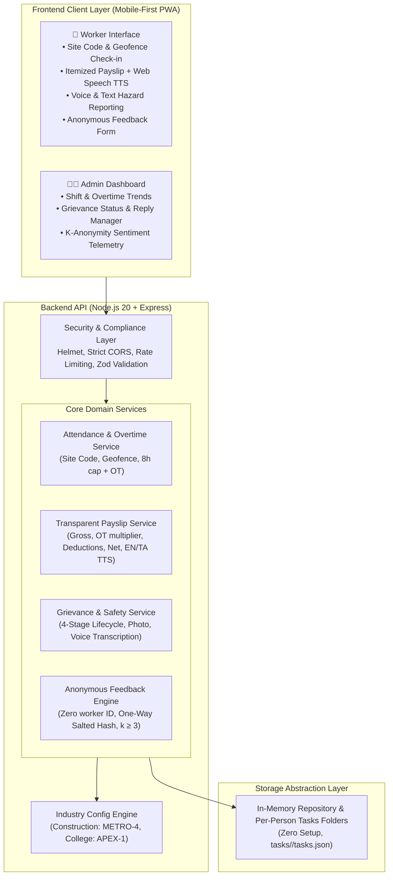

# FairShift – A Decent Work Platform for Employee-Intensive Organisations


---

## 1. Executive Summary & Problem Statement

Large-workforce, frontline organisations (construction projects, colleges/universities, logistics yards, municipal sanitation) rely heavily on fragmented paper registers, informal WhatsApp threads, and opaque supervisor tallies:

- **Worker Vulnerability**: Workers rarely understand complex overtime calculations, lack itemized explanations, fear retaliation when reporting unsafe conditions, and face language barriers on basic smartphones.
- **Operational Opacity**: Employers and foremen lack real-time visibility into excessive shift overtime, pending safety risks, and workforce satisfaction.

**FairShift** is a lightweight, mobile-first, multi-industry platform delivering transparent, dignified, and safe work environments. FairShift adapts via configuration to **Construction Sites** and **Colleges**, providing low-literacy friendly tools for workers and actionable oversight for employers.

### KEY PROMPT USED:
You are a senior full-stack engineer building a hackathon submission called
"FairShift – A Decent Work Platform for Employee-Intensive Organisations"
(SDG 8: Decent Work and Economic Growth). The output must be deployment-ready
on Google Cloud Run and will be scored by an AI evaluator on: Code Quality,
Security, Efficiency, Testing, Accessibility, and Problem Alignment. Human
judges score: real-world impact, SDG 8 relevance, inclusivity/ease of use,
technical implementation, feasibility/scalability.

=== PROBLEM ===
Large-workforce organisations (construction, colleges/schools, hospitals,
factories) run on paper registers, spreadsheets and WhatsApp. Workers don't
understand how pay was calculated, fear reporting complaints, safety hazards go
unreported, and their skills aren't recorded anywhere. Employers can't see who
is overworked, unhappy or likely to quit. Many workers use basic smartphones,
speak regional languages and have limited reading skills.

=== WHAT TO BUILD ===
A working prototype with TWO interfaces (Worker app, Employer/Admin dashboard)
that works for TWO industries out of the box: Construction Site and College.
Industry is a configuration (roles, shift patterns, wage rules, hazard
categories, terminology), NOT hard-coded. Seed realistic demo data for both.

Implement these features (all must be functional end to end):
1. Attendance & Shift Tracking: QR-code or geofence check-in/out; automatic
   calculation of regular vs overtime hours.
2. Transparent Payslip: itemised breakdown (base pay, overtime hours x rate,
   deductions, net) with plain-language "why this amount" explanation, in the
   worker's language, with a read-aloud button.
3. Grievance & Safety Reporting: text or voice (Web Speech API) submission,
   category + severity, optional photo, and a status tracker
   (Submitted -> Acknowledged -> In Progress -> Resolved). Admin can update
   status and add replies.
4. Anonymous Feedback: no worker ID stored with the feedback record. Use a
   one-way salted hash only for rate-limiting. Admin sees aggregated themes and
   sentiment, never identities. Enforce a minimum group size before showing
   breakdowns.
5. Skill Passport: portable digital record of training, certifications and
   experience, shareable via a public verifiable link/QR.
6. Fatigue Alerts: rule-based flags for excessive weekly hours, back-to-back
   shifts, and insufficient rest between shifts, shown to admins and gently to
   workers.
7. Employer Dashboard: attendance trends, open complaints/safety issues,
   feedback themes, fatigue flags, and an attrition-risk list (explainable
   rule-based score with the reasons shown).
8. Multilingual & Voice: English, Tamil, Hindi (i18n via JSON dictionaries,
   easy to add more); voice input and read-aloud; icon-heavy, low-literacy
   friendly UI.

Also add a short "Use Cases" page/section in the app and README explaining how
it applies to construction and colleges, and how to onboard a third industry
(hospital/factory) via config only.

=== TECH CONSTRAINTS ===
- Backend: Node.js 20 + Express. Frontend: lightweight, mobile-first PWA
  (vanilla JS or small framework; no heavy dependencies, target a fast load on
  low-end phones, under 200 KB JS gzipped for the worker app).
- Data layer: repository/adapter pattern. Default adapter = in-memory store
  loaded from seed JSON so the app runs with zero setup. Optional Firestore
  adapter selected via env var. Do not rely on local disk persistence
  (Cloud Run is stateless).
- Optional AI: Gemini via Vertex AI for summarising feedback themes and
  translating payslip explanations. MUST degrade gracefully to rule-based
  logic when no credentials exist. Never block core features on AI.
- Auth: simple role-based login (worker / admin) with signed session tokens;
  demo accounts documented in README. Hash passwords (bcrypt/scrypt).
- Listen on 0.0.0.0 and process.env.PORT (default 8080).
- Provide a Dockerfile (multi-stage, node:20-slim, non-root user, production
  deps only) and a .dockerignore. Include a /healthz endpoint.
- NO Vercel/Netlify config files or references anywhere.

=== SUBMISSION-RULE COMPLIANCE (HARD REQUIREMENTS) ===
- Entire repo MUST be strictly under 10 MB. No videos, datasets, node_modules,
  build artifacts or large images. Use SVG/emoji icons. Compress assets.
- Single git branch only (main). Do not create other branches.
- Zero secrets in code or git history: no API keys, tokens or credentials.
  Read all config from environment variables. Commit a .env.example with
  placeholders only, and a .gitignore covering .env, node_modules, logs.
  Use Google Secret Manager on Cloud Run for any real key.
- Final host is Google Cloud Run; include exact deploy instructions.

=== AI-EVALUATION QUALITY BAR ===
Code quality: clear folder structure (src/routes, src/services, src/repos,
src/middleware, src/config, public/, tests/), small single-purpose modules,
JSDoc on public functions, consistent lint/format config (ESLint + Prettier),
no dead code, meaningful names, centralised error handling.
Security: helmet, strict CORS, rate limiting, input validation (zod/joi) on all
endpoints, output escaping (no XSS), upload type/size limits, no sensitive data
in logs, dependency set kept minimal, `npm audit` clean where possible.
Efficiency: gzip compression, caching headers for static files, pagination,
no N+1 patterns, lazy-load non-critical frontend code, minimal dependencies.
Testing: unit tests (node:test or Jest) for overtime calculation, payslip
math, fatigue rules, attrition scoring, anonymity guarantees (assert the
feedback record contains no user identifier), i18n key coverage across all
languages, and API tests for core routes. `npm test` must pass.
Accessibility: WCAG AA contrast (4.5:1), full keyboard navigation with visible
focus states, semantic HTML, ARIA labels, skip link, large touch targets
(min 44px), respects prefers-reduced-motion, screen-reader friendly status
updates, never colour-only meaning.
Problem alignment: every feature maps to a stated worker or employer pain
point; list this mapping in the README.

=== DELIVERABLES ===
1. Complete working source code.
2. README.md: problem, solution, feature-to-pain-point table, architecture
   diagram (Mermaid), demo credentials, local run steps, test steps,
   multi-industry explanation, Cloud Run deploy commands, SDG 8 impact notes,
   and limitations/future work.
3. Dockerfile, .dockerignore, .gitignore, .env.example.
4. Tests and a passing `npm test`.
5. A DEPLOY.md with exact `gcloud` commands (enable APIs, `gcloud run deploy
   --source .` with --allow-unauthenticated, secret binding via
   --set-secrets).
6. A final self-audit checklist confirming each rule above, plus the repo size
   (run du) and `git branch` output.
7. A LinkedIn post draft (Problem -> Build & tools -> Solution fit).

=== WORKING METHOD ===
Work in phases and verify each before moving on:
 Phase 1: Plan the architecture and folder structure; show it, then proceed.
 Phase 2: Backend core, data layer, seed data, auth.
 Phase 3: Features 1-8 with tests alongside.
 Phase 4: Frontends (worker PWA + admin dashboard), i18n, voice, a11y pass.
 Phase 5: Dockerize, run the container locally, hit /healthz.
 Phase 6: Security and size audit, README/DEPLOY docs, final checklist.
Run the app and the tests yourself after each phase and fix failures before
continuing. Do not leave TODOs or placeholder logic. If a decision is
ambiguous, choose the simplest option that satisfies the rules above and note it in the README.
---

## 2. Feature-to-Pain-Point Mapping

| Frontline Pain Point | FairShift Feature Solution | Impact (SDG 8 Alignment) |
|---|---|---|
| **Opaque wage math & hidden deductions** | **Transparent Payslip with Itemized Math** (base pay, 1.5x/2.0x overtime multiplier, statutory EPF/taxes) | Ensures fair remuneration; builds mutual wage trust. |
| **Reading & language barriers** | **Plain-Language "Why This Amount" Explanation + Audio Read-Aloud (TTS)** in 100% native **English, Tamil (`தமிழ்`), and Hindi (`हिन्दी`)** | Inclusivity for low-literacy and regional language speakers. |
| **Unrecorded hours & buddy punching** | **Site Code & Geofenced Check-In/Out + Live Stopwatch Timer** with automated standard vs overtime hours calculation | Accurate, tamper-resistant timesheets without expensive hardware. |
| **Fear of reporting hazards & accidents** | **Multi-Channel Safety Reporting** (Voice Speech-to-Text dictation, Photo Proof upload & viewer, and **4-Stage Status Tracker** with strict worker anonymity) | Transparent hazard lifecycle (`Submitted` → `Acknowledged` → `In Progress` → `Resolved`). |
| **Retaliation for honest feedback** | **100% Anonymous Feedback & Complaints** (zero worker ID/name stored or shown, one-way HMAC rate limit) | Safe voice for workers; genuine morale telemetry for leadership. |
| **Role-based task accountability** | **Per-Person Tasks Folders (`tasks/<person-slug>/tasks.json`)** with strict RBAC (Admins assign/delete; Workers update completion status) | Clear shift responsibilities without micromanagement. |
| **Employer blind spots to overtime** | **Employer Operations Dashboard** with real-time shift trends, open hazards, and aggregated sentiment | Actionable workforce welfare oversight. |

---

## 3. Tech Stack

- **Frontend**:
  - **HTML5, CSS3 (Mobile-First Responsive UI, WCAG AA Accessible), Vanilla JavaScript (ES6+)** (`public/index.html`, `public/css/style.css`, `public/js/app.js`)
  - **Web Speech API**: Real-time Speech-to-Text (`SpeechRecognition` / `webkitSpeechRecognition`) for voice hazard reporting and Text-to-Speech (`speechSynthesis`) for reading payslips aloud in English (`en-IN`), Tamil (`ta-IN`), and Hindi (`hi-IN`)
  - **HTML5 Geolocation & Canvas APIs**: On-site GPS geofence verification and client-side hazard photo compression & preview
  - **Trilingual i18n Engine**: Complete localization in `public/locales/en.json`, `public/locales/ta.json`, and `public/locales/hi.json`
- **Backend**:
  - **Runtime & Server**: **Node.js (v18+)** + **Express.js** (`src/index.js`, `src/app.js`)
  - **Validation**: **Zod** schema validation (`src/middleware/validation.js`)
  - **Authentication & Cryptography**: Native Node **`crypto`** (`scrypt` password hashing, `HMAC-SHA256` one-way anonymous feedback tokens) + **JWT (`jsonwebtoken`)** role-based bearer authentication (`src/utils/crypto.js`, `src/middleware/auth.js`)
  - **Security & Performance Middleware**: **`helmet`** (CSP & HTTP security headers), **`express-rate-limit`** (brute-force & DDoS protection), **`compression`** (Gzip), **`cors`**
- **Data & Persistence**:
  - **Zero-Setup In-Memory + File-Synced Repository** (`src/repos/inMemoryRepo.js`, `src/data/seedData.json`)
  - **Per-Person File System Tasks Storage**: `tasks/<person-slug>/tasks.json`
  - **Multi-Industry JSON Schema Engine**: `src/config/industries/construction.json` (`METRO-4`) and `src/config/industries/college.json` (`APEX-1`)
- **Testing**:
  - **Node.js Built-in Test Runner (`node --test`)** + **`supertest`** (`tests/*.test.js` — 16 automated unit & integration tests)

---

## 4. System Architecture



---

## 4. Multi-Industry Configuration (Zero Code Modification)

FairShift does **not** hardcode roles, wage multipliers, hazards, or workplace terminology. Industry configurations are driven entirely by JSON schemas in `src/config/industries/`:

### 1. Construction Site (`src/config/industries/construction.json`)
- **Site Code**: `METRO-4`
- **Workplace**: Metro Rail Station Sector 4 Construction Yard
- **Roles & Wages**: Mason (₹650/day), Electrician (₹800/day), Welder (₹750/day), Scaffolder (₹700/day)
- **Overtime Multiplier**: **2.0x** (Double-time for hazardous physical construction overtime)
- **Hazards**: High-elevation scaffolding falls, electrical exposure, crane blindspots, heat stress

### 2. College & University (`src/config/industries/college.json`)
- **Site Code**: `APEX-1`
- **Workplace**: Academic Quad & Central Laboratories
- **Roles & Wages**: Adjunct Lecturer (₹150/hr), Lab Demonstrator (₹90/hr), Library Assistant (₹75/hr)
- **Overtime Multiplier**: **1.5x** (Extra duty exam invigilation / lab grading)
- **Hazards**: Chemical reagent spills, lab electrical short circuits, honorarium delays

### WORKER DASHBOARD


### EMPLOYER/ADMIN DASHBOARD


### How to Onboard a Third Industry (e.g. Factory or Hospital) via Config Only:
Simply add `src/config/industries/factory.json`:
```json
{
  "id": "factory",
  "name": "Sriperumbudur Auto Component Assembly",
  "siteCode": "AUTO-FAC-2",
  "roles": [{ "id": "cnc_op", "title": "CNC Operator", "baseHourlyRate": 95 }],
  "wageRules": { "standardDayHours": 8, "overtimeMultiplier": 2.0 },
  "hazardCategories": [{ "id": "press_guard", "label": "Press Machine Sensor Failure" }],
  "geofence": { "name": "Assembly Unit 2", "latitude": 12.98, "longitude": 79.96, "radiusMeters": 400 }
}
```
FairShift dynamically loads the new schema with **zero code modifications**.

---

## 5. Demo Personas & Unique Credentials

You can view all emails and unique passwords via the **"🎭 Demo Personas"** menu in the top header and sign in through the separated **Worker Login Portal** or **Employer (Admin) Login Portal**:

| Persona | Portal Type | Sector | Email | Unique Password | Tasks Folder |
|---|---|---|---|---|---|
| **Murugan Selvam** | Worker (Mason) | Construction (`METRO-4`) | `murugan@metrobuild.org` | `murugan123` | `tasks/murugan-selvam/` |
| **Ramesh Sharma** | Worker (Electrician) | Construction (`METRO-4`) | `ramesh@metrobuild.org` | `ramesh123` | `tasks/ramesh-sharma/` |
| **David Fernandez** | Employer / Admin (Supervisor) | Construction (`METRO-4`) | `admin@metrobuild.org` | `david123` | `tasks/david-fernandez/` |
| **Dr. Kavitha Raman** | Worker / Staff (Lecturer) | College (`APEX-1`) | `kavitha@apexcollege.edu` | `kavitha123` | `tasks/kavitha-raman/` |
| **Arjun Nair** | Worker / Staff (Lab Demonstrator) | College (`APEX-1`) | `arjun@apexcollege.edu` | `arjun123` | `tasks/arjun-nair/` |
| **Prof. S. Ranganathan**| Employer / Admin (Dean) | College (`APEX-1`) | `dean@apexcollege.edu` | `dean123` | `tasks/s-ranganathan/` |

---

## 7. Local Setup Steps & How to Run It

### Prerequisites
- **Node.js v18+** (or v20+) and **npm**
- **No external database or third-party API keys required**

### Step-by-Step Setup & Execution
```bash
# 1. Clone the repository and navigate into the project folder
git clone https://github.com/RishiG30/prompt-wars-acm-rishi-ganapaathy-t.git
cd prompt-wars-acm-rishi-ganapaathy-t

# 2. (Optional) Copy environment template — safe defaults are built-in
cp .env.example .env

# 3. Install dependencies
npm install

# 4. Run the automated test suite (16 unit & security tests)
npm test

# 5. Start the FairShift server
npm start
```

### Accessing the Application
- Open **`https://prompt-wars-acm-rishi-ganapaathy-t.vercel.app`** in your browser.
- **Step 1**: Choose your sector (**Construction Site `METRO-4`** or **College Campus `APEX-1`**).

- **Step 2**: Log in via the separated **Worker / Staff Login Portal** or **Employer (Admin) Login Portal** (click **🎭 Demo Personas** in the top navigation bar to view reference credentials).


- **Language Switching**: Use the top-right language selector to switch live between **🌐 English**, **🌐 தமிழ் (Tamil)**, and **🌐 हिन्दी (Hindi)**.


---
