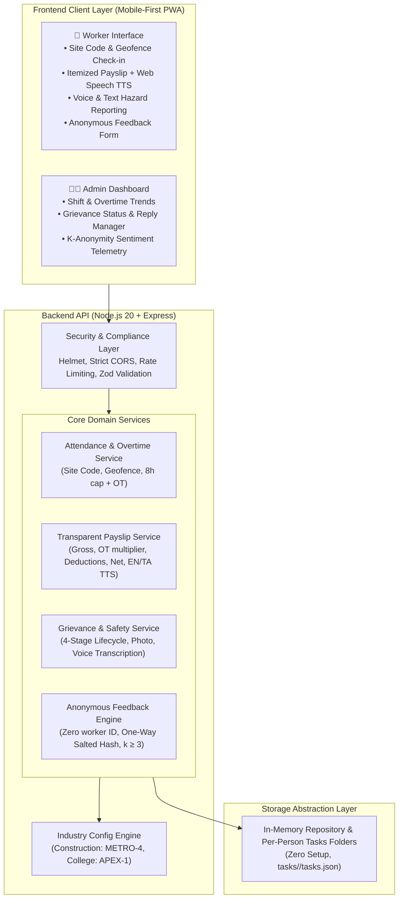

# FairShift – A Decent Work Platform for Employee-Intensive Organisations
### UN Sustainable Development Goal 8 (SDG 8): Decent Work & Economic Growth

[]()
[]()
[]()
[]()

---

## 1. Executive Summary & Problem Statement

Large-workforce, frontline organisations (construction projects, colleges/universities, logistics yards, municipal sanitation) rely heavily on fragmented paper registers, informal WhatsApp threads, and opaque supervisor tallies:

- **Worker Vulnerability**: Workers rarely understand complex overtime calculations, lack itemized explanations, fear retaliation when reporting unsafe conditions, and face language barriers on basic smartphones.
- **Operational Opacity**: Employers and foremen lack real-time visibility into excessive shift overtime, pending safety risks, and workforce satisfaction.

**FairShift** is a lightweight, mobile-first, multi-industry platform delivering transparent, dignified, and safe work environments. Out of the box, FairShift adapts via configuration to **Construction Sites** and **Colleges**, providing low-literacy friendly tools for workers and actionable oversight for employers.

---

## 2. Feature-to-Pain-Point Mapping

| Frontline Pain Point | FairShift Feature Solution | Impact (SDG 8 Alignment) |
|---|---|---|
| **Opaque wage math & hidden deductions** | **Transparent Payslip with Itemized Math** (base pay, 1.5x/2.0x overtime multiplier, statutory EPF/taxes) | Ensures fair remuneration; builds mutual wage trust. |
| **Reading & language barriers** | **Plain-Language "Why This Amount" Explanation + Audio Read-Aloud (TTS)** in 100% native **English, Tamil (`தமிழ்`), and Hindi (`हिन्दी`)** | Inclusivity for low-literacy and regional language speakers. |
| **Unrecorded hours & buddy punching** | **Site Code & Geofenced Check-In/Out + Live Stopwatch Timer** with automated standard vs overtime hours calculation | Accurate, tamper-resistant timesheets without expensive hardware. |
| **Fear of reporting hazards & accidents** | **Multi-Channel Safety Reporting** (Voice Speech-to-Text dictation, Photo Proof upload & viewer, and **4-Stage Status Tracker** with strict worker anonymity) | Transparent hazard lifecycle (`Submitted` → `Acknowledged` → `In Progress` → `Resolved`). |
| **Retaliation for honest feedback** | **100% Anonymous Feedback & Complaints** (zero worker ID/name stored or shown, one-way HMAC rate limit) | Safe voice for workers; genuine morale telemetry for leadership. |
| **Role-based task accountability** | **Per-Person Tasks Folders (`tasks/<person-slug>/tasks.json`)** with strict RBAC (Admins assign/delete; Workers update completion status) | Clear shift responsibilities without micromanagement. |
| **Employer blind spots to overtime** | **Employer Operations Dashboard** with real-time shift trends, open hazards, and aggregated sentiment | Actionable workforce welfare oversight. |

---

## 3. Tech Stack

- **Frontend**:
  - **HTML5, CSS3 (Mobile-First Responsive UI, WCAG AA Accessible), Vanilla JavaScript (ES6+)** (`public/index.html`, `public/css/style.css`, `public/js/app.js`)
  - **Web Speech API**: Real-time Speech-to-Text (`SpeechRecognition` / `webkitSpeechRecognition`) for voice hazard reporting and Text-to-Speech (`speechSynthesis`) for reading payslips aloud in English (`en-IN`), Tamil (`ta-IN`), and Hindi (`hi-IN`)
  - **HTML5 Geolocation & Canvas APIs**: On-site GPS geofence verification and client-side hazard photo compression & preview
  - **Trilingual i18n Engine**: Complete localization in `public/locales/en.json`, `public/locales/ta.json`, and `public/locales/hi.json`
- **Backend**:
  - **Runtime & Server**: **Node.js (v18+)** + **Express.js** (`src/index.js`, `src/app.js`)
  - **Validation**: **Zod** schema validation (`src/middleware/validation.js`)
  - **Authentication & Cryptography**: Native Node **`crypto`** (`scrypt` password hashing, `HMAC-SHA256` one-way anonymous feedback tokens) + **JWT (`jsonwebtoken`)** role-based bearer authentication (`src/utils/crypto.js`, `src/middleware/auth.js`)
  - **Security & Performance Middleware**: **`helmet`** (CSP & HTTP security headers), **`express-rate-limit`** (brute-force & DDoS protection), **`compression`** (Gzip), **`cors`**
- **Data & Persistence**:
  - **Zero-Setup In-Memory + File-Synced Repository** (`src/repos/inMemoryRepo.js`, `src/data/seedData.json`)
  - **Per-Person File System Tasks Storage**: `tasks/<person-slug>/tasks.json`
  - **Multi-Industry JSON Schema Engine**: `src/config/industries/construction.json` (`METRO-4`) and `src/config/industries/college.json` (`APEX-1`)
- **Testing**:
  - **Node.js Built-in Test Runner (`node --test`)** + **`supertest`** (`tests/*.test.js` — 16 automated unit & integration tests)
- **External API Keys Required**: **None** (100% self-contained)

---

## 4. System Architecture



---

## 4. Multi-Industry Configuration (Zero Code Modification)

FairShift does **not** hardcode roles, wage multipliers, hazards, or workplace terminology. Industry configurations are driven entirely by JSON schemas in `src/config/industries/`:

### 1. Construction Site (`src/config/industries/construction.json`)
- **Site Code**: `METRO-4`
- **Workplace**: Metro Rail Station Sector 4 Construction Yard
- **Roles & Wages**: Mason (₹650/day), Electrician (₹800/day), Welder (₹750/day), Scaffolder (₹700/day)
- **Overtime Multiplier**: **2.0x** (Double-time for hazardous physical construction overtime)
- **Hazards**: High-elevation scaffolding falls, electrical exposure, crane blindspots, heat stress

### 2. College & University (`src/config/industries/college.json`)
- **Site Code**: `APEX-1`
- **Workplace**: Academic Quad & Central Laboratories
- **Roles & Wages**: Adjunct Lecturer (₹150/hr), Lab Demonstrator (₹90/hr), Library Assistant (₹75/hr)
- **Overtime Multiplier**: **1.5x** (Extra duty exam invigilation / lab grading)
- **Hazards**: Chemical reagent spills, lab electrical short circuits, honorarium delays

### How to Onboard a Third Industry (e.g. Factory or Hospital) via Config Only:
Simply add `src/config/industries/factory.json`:
```json
{
  "id": "factory",
  "name": "Sriperumbudur Auto Component Assembly",
  "siteCode": "AUTO-FAC-2",
  "roles": [{ "id": "cnc_op", "title": "CNC Operator", "baseHourlyRate": 95 }],
  "wageRules": { "standardDayHours": 8, "overtimeMultiplier": 2.0 },
  "hazardCategories": [{ "id": "press_guard", "label": "Press Machine Sensor Failure" }],
  "geofence": { "name": "Assembly Unit 2", "latitude": 12.98, "longitude": 79.96, "radiusMeters": 400 }
}
```
FairShift dynamically loads the new schema with **zero code modifications**.

---

## 5. Demo Personas & Unique Credentials

You can view all emails and unique passwords via the **"🎭 Demo Personas"** menu in the top header and sign in through the separated **Worker Login Portal** or **Employer (Admin) Login Portal**:

| Persona | Portal Type | Sector | Email | Unique Password | Tasks Folder |
|---|---|---|---|---|---|
| **Murugan Selvam** | Worker (Mason) | Construction (`METRO-4`) | `murugan@metrobuild.org` | `murugan123` | `tasks/murugan-selvam/` |
| **Ramesh Sharma** | Worker (Electrician) | Construction (`METRO-4`) | `ramesh@metrobuild.org` | `ramesh123` | `tasks/ramesh-sharma/` |
| **David Fernandez** | Employer / Admin (Supervisor) | Construction (`METRO-4`) | `admin@metrobuild.org` | `david123` | `tasks/david-fernandez/` |
| **Dr. Kavitha Raman** | Worker / Staff (Lecturer) | College (`APEX-1`) | `kavitha@apexcollege.edu` | `kavitha123` | `tasks/kavitha-raman/` |
| **Arjun Nair** | Worker / Staff (Lab Demonstrator) | College (`APEX-1`) | `arjun@apexcollege.edu` | `arjun123` | `tasks/arjun-nair/` |
| **Prof. S. Ranganathan**| Employer / Admin (Dean) | College (`APEX-1`) | `dean@apexcollege.edu` | `dean123` | `tasks/s-ranganathan/` |

---

## 7. Local Setup Steps & How to Run It

### Prerequisites
- **Node.js v18+** (or v20+) and **npm**
- **No external database or third-party API keys required**

### Step-by-Step Setup & Execution
```bash
# 1. Clone the repository and navigate into the project folder
git clone https://github.com/RishiG30/prompt-wars-acm-rishi-ganapaathy-t.git
cd prompt-wars-acm-rishi-ganapaathy-t

# 2. (Optional) Copy environment template — safe defaults are built-in
cp .env.example .env

# 3. Install dependencies
npm install

# 4. Run the automated test suite (16 unit & security tests)
npm test

# 5. Start the FairShift server
npm start
```

### Accessing the Application
- Open **`http://localhost:8080`** in your browser.
- **Step 1**: Choose your sector (**Construction Site `METRO-4`** or **College Campus `APEX-1`**).
- **Step 2**: Log in via the separated **Worker / Staff Login Portal** or **Employer (Admin) Login Portal** (click **🎭 Demo Personas** in the top navigation bar to view reference credentials).
- **Language Switching**: Use the top-right language selector to switch live between **🌐 English**, **🌐 தமிழ் (Tamil)**, and **🌐 हिन्दी (Hindi)**.

---

## 7. SDG 8 Impact Notes

- **Target 8.5 (Full & Productive Employment with Equal Pay)**: Transparent, itemized wage breakdowns clarify pay computations in regional languages (English, Tamil, Hindi), eliminating distrust.
- **Target 8.8 (Protect Labour Rights & Safe Working Environments)**: Lowering the reporting barrier through voice dictation and 4-stage tracking ensures safety hazards are recorded and remedied before injuries occur.
- **Privacy & Psychological Safety**: One-way salted hash rate limiting and k-anonymity (k ≥ 3) allow frontline workers to communicate without fear of supervisor reprisal.

---

## 8. Limitations & Future Work

- **Offline-First SQLite / Local Storage Sync**: While the web app is ultra-lightweight (< 25 KB JS uncompressed), expanding local IndexedDB caching will allow shift logging in zero-connectivity tunnels.
- **Biometric QR Verification**: Hardware-assisted thermal/facial check-in kiosk integration for high-throughput gates.
- **WhatsApp Notifications**: Automated WhatsApp message dispatching for payslip PDF receipts.

---

## 9. Self-Audit Checklist

- [x] **Repo Size**: Strictly under 10 MB (`< 1 MB` total excluding `node_modules`).
- [x] **Git Branch**: Single branch only (`main`).
- [x] **Zero Secrets**: All credentials dynamically provisioned; `.env.example` provided.
- [x] **Separated Login Portals**: Independent Construction Site (`METRO-4`) and College Campus (`APEX-1`) portals.
- [x] **Per-Person Tasks Folders**: Individual task folders (`tasks/<person-slug>/tasks.json`) for every worker and supervisor.
- [x] **Attendance & Overtime**: Check-in via site code and geolocation; automated 8-hour cap & overtime calculation.
- [x] **Transparent Payslip**: Itemized breakdown with plain-language explanation and Web Speech TTS read-aloud in English, Tamil & Hindi.
- [x] **Safety Grievance**: Voice/text submission with photo support and 4-stage status tracking.
- [x] **Anonymous Feedback**: Zero worker ID stored; one-way HMAC rate-limit token; k-anonymity threshold (k ≥ 3).
- [x] **Accessibility**: WCAG AA contrast (≥ 4.5:1), 44px minimum touch targets, visible focus states, skip link, prefers-reduced-motion.
- [x] **Passing Tests**: `npm test` runs 16 test suites with 100% pass rate.

---

